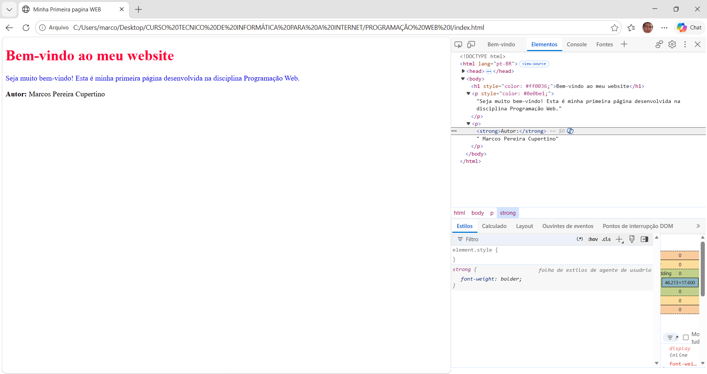
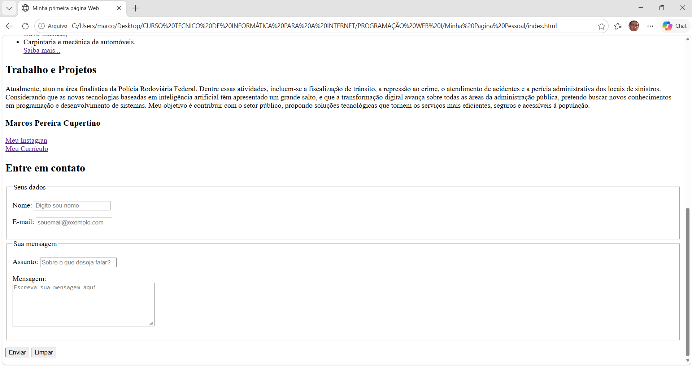

# Minha primeira página Web
Nome: Marcos Pereira Cupertino

## Sobre a atividade

Esta é minha primeira página desenvolvida na disciplina
Programação Web.

## Tecnologias utilizadas

- HTML
- Git
- GitHub

- ## Captura de tela

## Captura de tela

